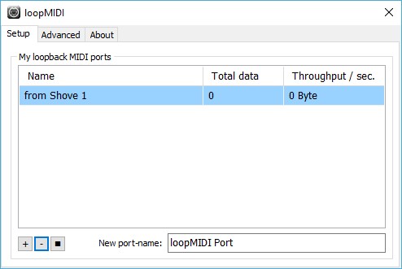

# FaderDeck — instalação e configuração

Este é o guia principal do aplicativo. No GitHub, o arquivo `README.md` da raiz é o que aparece automaticamente na página inicial do repositório.

**Site oficial:** <https://fader-deck.vercel.app/>

**Versão atual:** 1.0.4

O aplicativo desktop não exige Node.js, npm nem comandos no Terminal. No Windows, porém, esta implementação precisa do loopMIDI para criar a porta MIDI virtual. No macOS, o próprio FaderDeck cria essa porta.

## Downloads

Baixe a versão atual (1.0.4) para seu sistema:

- **Windows 64-bit:** [Baixar FaderDeck para Windows](https://github.com/Paylo4002ansatsu/FaderDeck/releases/download/1.0.4/FaderDeck-Windows-Setup.exe). Windows 32-bit não é compatível com o instalador atual.
- **macOS:** [Baixar FaderDeck para macOS](https://github.com/Paylo4002ansatsu/FaderDeck/releases/download/1.0.4/FaderDeck-Mac.dmg). O pacote é universal e atende Macs Intel e Apple Silicon.

Para ver o passo a passo ilustrado, com imagens, destaques e esquemas identificados, abra o [guia visual completo para Windows](https://fader-deck.vercel.app/guia-midi-windows.html).

## Windows — instalação e primeiro uso

### 1. Instale o FaderDeck

1. Baixe o instalador `.exe` pelo link acima.
2. Execute-o e siga as etapas do instalador.
3. Abra o FaderDeck pelo menu Iniciar ou pelo atalho criado.

Não instale Node.js para usar o aplicativo desktop.

### 2. Instale o loopMIDI e crie a porta virtual

O FaderDeck para Windows não cria a porta MIDI virtual sozinho. Baixe o loopMIDI somente pela [página oficial de Tobias Erichsen](https://www.tobias-erichsen.de/software/loopmidi.html), execute o instalador e abra o programa pelo menu Iniciar.

Na janela do loopMIDI, digite `FaderDeck` no campo **New port-name**, clique em **+** e confirme que a porta aparece na lista. A imagem abaixo é uma captura real de outra instalação: o nome mostrado nela é apenas exemplo, mas o campo e os controles são os mesmos.

Fonte da captura: [tutorial Silence & Sound sobre loopMIDI](https://www.silenceandsound.com/setup-loopmidi/).

**Mantenha o loopMIDI aberto ou minimizado na bandeja do Windows.** A porta deixa de funcionar se o programa for encerrado. Se houver uma opção de inicialização automática no menu do ícone da bandeja, ative-a para iniciar o loopMIDI a cada logon.

### 3. Selecione a saída MIDI no FaderDeck

1. Com o FaderDeck aberto, vá ao menu superior e clique em FaderDeck
2. Escolha **Portas MIDI e administração…**.
3. Em **Saída MIDI para a DAW**, selecione **FaderDeck**.
4. Clique em **Aplicar portas MIDI** e espere a confirmação.

O endereço local padrão da administração é `http://127.0.0.1:8787/bridge`. Se a porta 8787 estiver ocupada, o app seleciona outra porta livre; abra a administração pelo menu do FaderDeck, que usa o endereço correto.

**Entrada MIDI para MIDI Learn** é opcional e serve para receber um controlador MIDI externo. Para enviar os controles do FaderDeck à DAW, configure a saída.

### 4. Conecte o celular

1. Deixe o computador e o celular na mesma rede Wi‑Fi.
2. Na primeira conexão, abra **Portas MIDI e administração…** no FaderDeck e baixe o certificado CA exibido na tela. Transfira o arquivo ao celular por um meio confiável e compare a impressão digital SHA-256 com a mostrada no computador antes de confiar nele.
3. Instale e confie no certificado CA nas configurações de segurança do celular. No iPhone, instale o perfil em **Ajustes → Geral → VPN e Gerenciamento de Dispositivo** e habilite confiança total em **Ajustes → Geral → Sobre → Ajustes de Confiança de Certificados**. No Android, use a opção do sistema para instalar um certificado CA; os nomes variam por fabricante.
4. Depois da instalação, escaneie o QR exibido na tela. O controle remoto usa HTTPS/WSS; o código de pareamento fica no fragmento do link e não é enviado na requisição inicial.
5. Se o Firewall do Windows perguntar, permita conexões do FaderDeck em redes privadas. Redes Wi‑Fi de convidados podem bloquear a comunicação entre aparelhos.

### 5. Habilite a entrada na sua DAW

Se a DAW já estava aberta quando você criou a porta, feche-a e abra novamente. Alguns programas só atualizam a lista de dispositivos MIDI na inicialização. Em cada programa, selecione e habilite a entrada **FaderDeck**:

- **ChurchDAW:** em `Sistema → Áudio e MIDI`, selecione FaderDeck como entrada. Depois, em `Ferramentas → Mapear MIDI`, clique no controle desejado na tela e mova o fader. O mapeamento é salvo no projeto.
- **Kontakt:** abra `Options → MIDI`, selecione FaderDeck na lista de portas MIDI de entrada e ative-a. Em seguida, clique no controle ou parâmetro desejado no Kontakt e use o recurso MIDI Learn do plugin, movendo o fader correspondente no FaderDeck.

Por enquanto, o FaderDeck anuncia suporte documentado somente para **ChurchDAW** e **Kontakt**. Consulte o [guia visual Windows](https://fader-deck.vercel.app/guia-midi-windows.html) para os passos de configuração.

## macOS

1. Baixe e abra o arquivo `.dmg`.
2. Arraste o FaderDeck para **Aplicativos**.
3. Na primeira abertura, o macOS pode avisar que o app não é de um desenvolvedor identificado por ele não estar assinado/notarizado. Se isso ocorrer, Control-clique no app, escolha **Abrir** e confirme. Se necessário, autorize em **Ajustes do Sistema → Privacidade e Segurança**.
4. Permita o acesso à rede local e as conexões de entrada no Firewall quando solicitados.
5. O FaderDeck cria automaticamente a porta MIDI virtual **FaderDeck**. Não é necessário ativar o IAC Driver. Se já existir uma porta IAC com o mesmo nome, use apenas uma das duas.
6. Para usar o iPhone, mantenha-o na mesma rede Wi‑Fi do Mac e escaneie o QR exibido pelo FaderDeck.

No macOS, layouts, token de pareamento, identidade da autoridade certificadora local e dados do painel são guardados fora do app em `~/Library/Application Support/FaderDeck` e preservados nas atualizações. Não compartilhe o arquivo privado da autoridade certificadora; somente o certificado público `faderdeck-local-ca.crt` deve ser instalado no celular. A administração local usa HTTP em loopback; a porta HTTPS da rede começa em `8788` e pode avançar se estiver ocupada.

## Solução de problemas

- **A porta não aparece:** confirme que o loopMIDI está aberto, que `FaderDeck` aparece na lista do loopMIDI e que a DAW foi reiniciada depois de criar a porta.
- **A DAW não responde:** confirme a saída selecionada no FaderDeck, clique **Aplicar portas MIDI**, habilite a entrada correta na DAW e repita o fluxo MIDI Learn.
- **O celular não conecta:** confira se os aparelhos estão na mesma rede Wi‑Fi, se o certificado CA do FaderDeck está instalado e confiável, e se o Firewall permite conexões locais em rede privada. Redes de convidados podem bloquear dispositivos entre si.
- **A porta some ao reiniciar o Windows:** reabra o loopMIDI, recrie `FaderDeck` se necessário e procure no menu do ícone da bandeja a opção de inicialização automática.
- **MIDI Learn não funciona:** confira o canal e o número CC/nota, e confirme que o tipo de mensagem enviado pelo controle é compatível com o que a DAW espera.

## Ponte standalone (opcional)

O instalador desktop é o caminho recomendado e não requer Node.js. Estas etapas são somente para executar o pacote separado `fader-bridge.zip`:

1. Instale Node.js 22 ou superior (LTS) e confirme no PowerShell/Terminal: `node -v` e `npm -v`.
2. No Windows, instale e abra loopMIDI e crie a porta `FaderDeck`; no macOS, a ponte cria a porta automaticamente.
3. Extraia o ZIP, abra o PowerShell/Terminal nessa pasta e rode `npm install` na primeira vez; depois rode `npm start`.
4. Abra `http://127.0.0.1:8787/bridge` no computador. Se 8787 estiver ocupada, use o endereço informado pelo servidor.
5. Na primeira conexão, baixe o certificado CA na tela, transfira-o ao celular por um meio confiável, confira a impressão digital e instale/confie no certificado.
6. Na tela da ponte, selecione a saída MIDI e clique **Aplicar portas MIDI**. Use o QR para conectar o celular na mesma rede local por HTTPS.

Se o módulo nativo `@julusian/midi` precisar ser compilado e a instalação falhar, no Windows instale Python 3 e Visual Studio Build Tools com a carga de trabalho C++ Desktop. No macOS, instale as ferramentas de linha de comando do Xcode com `xcode-select --install`. Não exponha a ponte à internet nem encaminhe a porta HTTPS LAN no roteador.

## Desenvolvimento

Somente para quem vai executar ou empacotar o código-fonte: o projeto requer Node.js 22 ou mais recente; Python 3 é necessário para reconstruir o ZIP da ponte. Instale dependências com `npm install`, valide com `npm run check` e gere o ZIP atualizado com `npm run package:bridge`. Os instaladores Electron são gerados pelo workflow de release do GitHub Actions.
